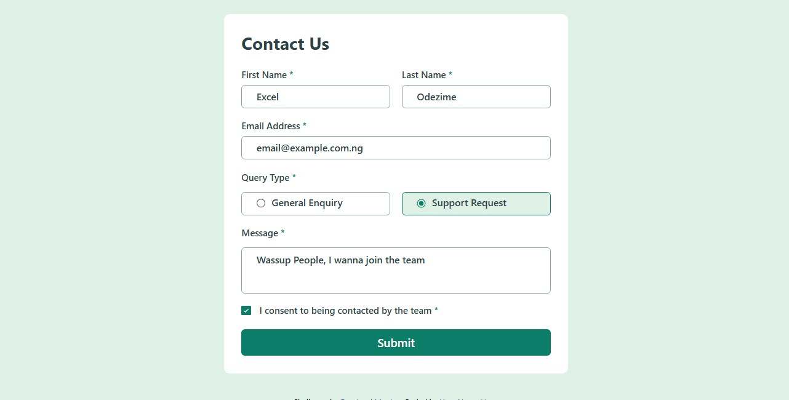

# Frontend Mentor - Contact form solution

This is a solution to the [Contact form challenge on Frontend Mentor](https://www.frontendmentor.io/challenges/contact-form--G-hYlqKJj). Frontend Mentor challenges help you improve your coding skills by building realistic projects. 

## Table of contents

- [Overview](#overview)
  - [The challenge](#the-challenge)
  - [Screenshot](#screenshot)
  - [Links](#links)
- [My process](#my-process)
  - [Built with](#built-with)
  - [What I learned](#what-i-learned)
- [Author](#author)
- [Acknowledgments](#acknowledgments)

## Overview

### The challenge

Users should be able to:

- Complete the form and see a success toast message upon successful submission
- Receive form validation messages if:
  - A required field has been missed
  - The email address is not formatted correctly
- Complete the form only using their keyboard
- Have inputs, error messages, and the success message announced on their screen reader
- View the optimal layout for the interface depending on their device's screen size
- See hover and focus states for all interactive elements on the page

### Screenshot



### Links

- Solution URL: [Add solution URL here](https://github.com/master-x2000/team-contact/)
- Live Site URL: [Add live site URL here](https://master-x2000.github.io/team-contact/)

## My process

### Built with

- Semantic HTML5 markup
- CSS custom properties
- Flexbox
- Desktop-first workflow
- JavaScript

### What I learned

Making use of radio buttons is not what I usually explore, so this challenge really made me to expand my knowledge in it. From creating the radio btn, styling, orgaizing the click events and getting the input.

```html
<section class="query">
  <label class="query-header">
    Query Type <span class="required">*</span>
  </label>
  <div class="radio-btn">
    <div class="query-control">
      <input type="radio" name="query" class="query-radio" value="General Enquiry">
      
      <p class="query-value" >
        General Enquiry
      </p>
    </div>
    
    <div class="query-control">
      <input type="radio" name="query" class="query-radio" value="Support Request">
      
      <p class="query-value">
        Support Request
      </p>
    </div>
  </div>
  <div class="error"></div>
</section>
```

```js
const queryControl = document.querySelectorAll(".query-control");
queryControl.forEach(queryControl => {

    queryControl.addEventListener("click", event => {
        const activeQuery = document.querySelector(".selected");
        if(activeQuery) { // Cancel active Query
            activeQuery.classList.remove("selected");
        }
        const queryRadio = queryControl.querySelector(".query-radio");

        const inputControl = document.querySelector(".query");
        queryRadio.addEventListener("click", event => {
            inputControl.classList.remove("fail");
        }); // Removes error after query type has been choosen

        queryRadio.click(); // Activates the radio btn
        queryInput = queryRadio.value;
        queryControl.classList.add("selected");
    });
});
const queryValue = queryInput;
if(queryValue === "" ) { // Testing the query input value
        setQueryError("Please select a query type");
        errorCount++;
    } else {
        setQuerySuccess();
    }
```

## Author

- WhatsApp - [Odezime Excel](https://wa.me/+2349132772631)
- Frontend Mentor - [@Master-X2000](https://www.frontendmentor.io/profile/Master-x2000)
- Twitter - [@Odezime Excel](https://www.twitter.com/EOdezime66661)
